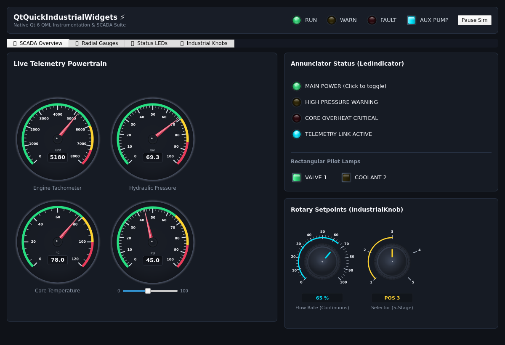
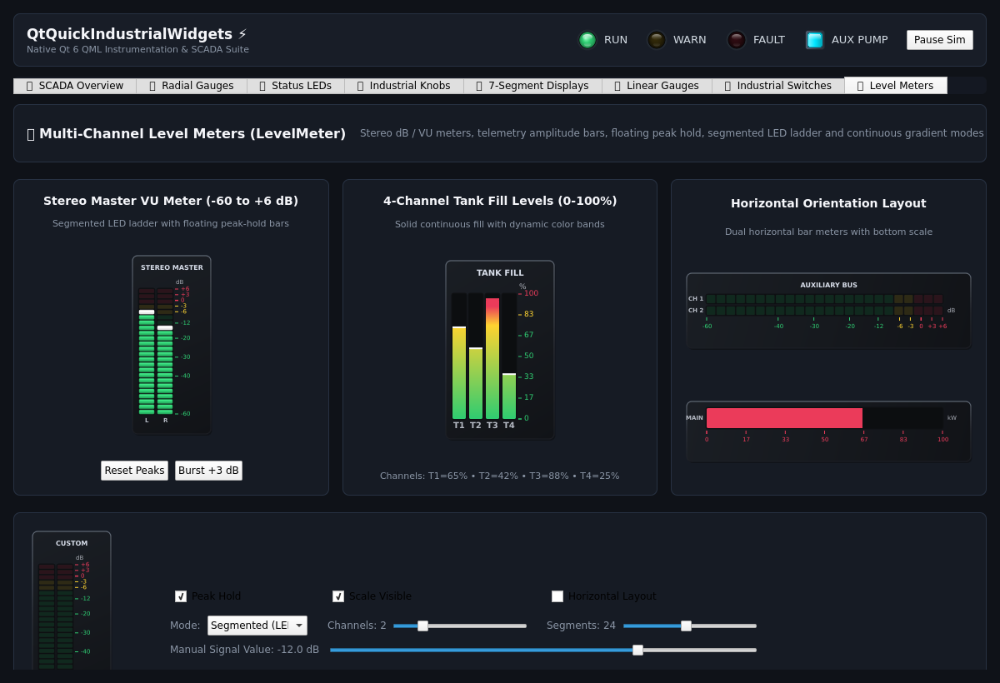
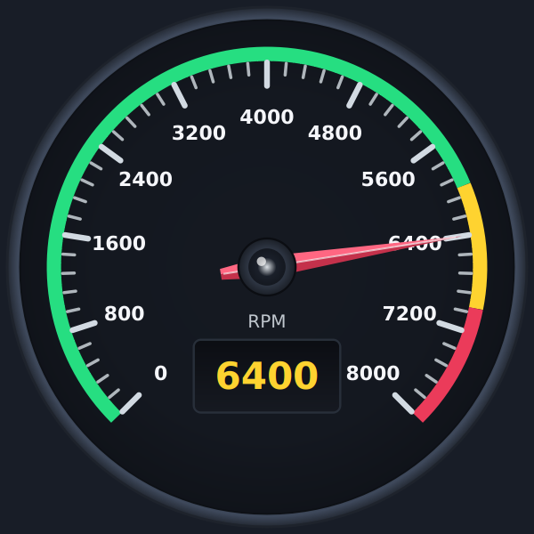
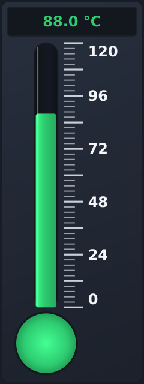
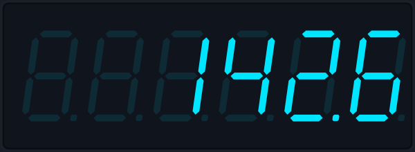
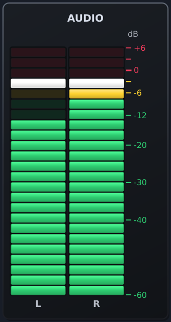
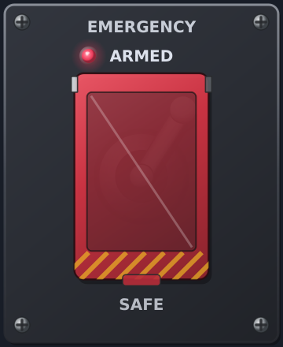
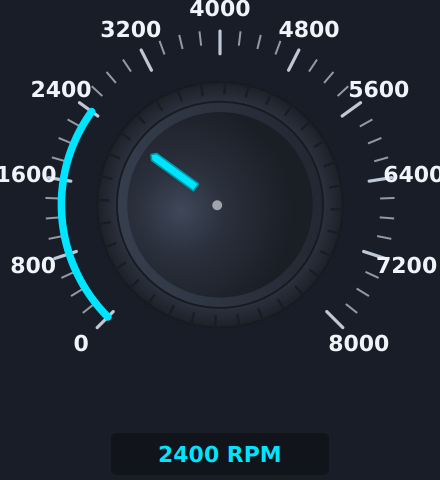

<!--
SPDX-FileCopyrightText: 2026 Paolo Sereno <pablitos1024@gmail.com>

SPDX-License-Identifier: MIT
-->

# QtQuickIndustrialWidgets ⚡

[](LICENSE)
[-41CD52.svg?logo=qt)](https://www.qt.io/)
[-yellow.svg)](#status)
[](https://api.reuse.software/info/github.com/paolosereno/QtQuickIndustrialWidget)

A modern, high-performance **Qt Quick / QML** instrumentation and SCADA widget suite designed for embedded Linux, touchscreens, test benches, automotive clusters, and industrial HMIs.

This project is the native Qt Quick evolution of the [**QtIndustrialWidgets**](https://github.com/paolosereno/QtIndustrialWidgets) (`QtWidgets`) C++ library.

<p align="center">
  <br>
  <em>SCADA Powertrain Dashboard & Live Telemetry Overview</em>
</p>

<p align="center">
  <br>
  <em>Multi-Channel Stereo dB VU Meters & Telemetry Tank Levels Showcase</em>
</p>

---

> [!WARNING]
> ### ⚠️ Project Status: Initial Development / Experimental
> This library is currently in an **early, initial stage of development**.
> The widgets, QML APIs, property names, and behavior are **not yet considered stable** and may undergo breaking changes, refactoring, and substantial revisions. Do not use in critical production environments without thorough testing.

---

## 🎯 Vision & Goals

While the original `QtIndustrialWidgets` excels in traditional desktop `QtWidgets` applications, modern industrial HMIs, automotive dashboards, and medical devices increasingly demand:

- **GPU Acceleration:** High frame rates (60+ FPS) with minimal CPU load via Qt Quick Scene Graph (`QSGNode`) and native `QtQuick.Shapes`.
- **Touch-Friendly Controls:** Smooth capacitive-touch gestures, fluid animations, and responsive state transitions.
- **Declarative QML API:** Clean property bindings, easy theming, and modern design integration without boilerplate code.
- **Cross-Platform & Embedded Ready:** Optimized for desktop (Windows, macOS, Linux) and resource-constrained embedded targets (Raspberry Pi, Toradex, i.MX8, STM32MP1).

---

## 🎛 Implemented Widgets

| Widget | Showcase |
|---|---|
| **`RadialGauge`**<br>0–8000 RPM dial, faceted vector needle in warning zone, digital LCD pod, threshold bands |  |
| **`CircularBargraph`**<br>24 curved LED segments, Bar/Dot modes, dynamic color zones, peak hold, LCD readout pod |  |
| **`LinearGauge`**<br>Thermometer mode, 0–120 °C with bulb capillary, dynamic liquid color shift and specular glare |  |
| **`SevenSegmentDisplay`**<br>Six digits, one decimal, italic skewed segments, unlit ghost segments and color presets |  |
| **`LevelMeter`**<br>Multi-channel stereo dB/VU meter, floating peak hold, segmented LED ladder and continuous gradient modes |  |
| **`IndustrialSwitch`**<br>Guarded crimson flip-up safety cover, toggle bat handle, rocker paddle, pilot LED, 2/3 positions |  |
| **`LedIndicator`**<br>3D spherical lens diffusion, ambient halo glow, machined bezel, blinking timer |  |
| **`IndustrialKnob`**<br>Continuous 0–8000 RPM knob with CNC knurled serrations, illuminated arc and digital pod |  |

---

## 🗺️ Roadmap & Remaining Widgets

The remaining 4 industrial widgets from the original C++ suite are tracked in the [Project Roadmap](https://github.com/users/paolosereno/projects/4):

| Category | Component | Description | Tracking Issue |
| :--- | :--- | :--- | :---: |
| **Gauges & Dials** | `Compass` | Heading indicator card with heading bug alignment and bearing scale | [Issue #5](https://github.com/paolosereno/QtQuickIndustrialWidget/issues/5) |
| **Alarms & Charts** | `AnnunciatorPanel` | ISA-18.1 compliant alarm annunciator tiles (unack, ack, ringback) | [Issue #7](https://github.com/paolosereno/QtQuickIndustrialWidget/issues/7) |
| | `StripChart` | High-frequency rolling telemetry stream plotting (60 FPS) | [Issue #8](https://github.com/paolosereno/QtQuickIndustrialWidget/issues/8) |
| | `AnalysisChart` | Historical data review chart with zoom/pan capabilities and dual cursors | [Issue #9](https://github.com/paolosereno/QtQuickIndustrialWidget/issues/9) |

---

## 🏗 Quick Start in QML

The library is packaged as a standard Qt 6 QML module (`QtQuickIndustrialWidgets`):

```qml
import QtQuick
import QtQuick.Controls
import QtQuickIndustrialWidgets

Item {
    width: 800
    height: 480

    Row {
        anchors.centerIn: parent
        spacing: 30

        LedIndicator {
            labelText: "SYSTEM READY"
            on: true
            onColor: "#2ecc71"
        }

        RadialGauge {
            width: 220
            height: 220
            value: 65.0
            minimum: 0
            maximum: 100
            unit: "bar"
            warningThreshold: 75
            errorThreshold: 90
        }

        LinearGauge {
            width: 110
            height: 260
            thermometerMode: true
            value: 42.5
            minimum: -20
            maximum: 100
            unit: "°C"
        }

        IndustrialKnob {
            width: 180
            height: 220
            value: 40.0
            minimum: 0
            maximum: 100
            unit: "%"
        }

        CircularBargraph {
            width: 180
            height: 180
            value: 68.5
            minimum: 0
            maximum: 100
            unit: "%"
            warningThreshold: 70
            errorThreshold: 85
            peakHoldEnabled: true
        }

        SevenSegmentDisplay {
            width: 220
            height: 70
            digitCount: 5
            decimalPlaces: 1
            value: 124.8
            colorPreset: "amber"
        }
    }
}
```

---

## 🚀 Building & Running the Gallery

The project provides an interactive SCADA dashboard gallery demonstrating the components with live simulated telemetry and interactive controls.

### Prerequisites
- Qt 6.5+ (`qtbase`, `declarative`, `quick`, `quickshapes`)
- CMake 3.21+
- C++17 compatible compiler (GCC, Clang, or MSVC)

### Build Instructions
```bash
# Configure
cmake -B build -DCMAKE_BUILD_TYPE=Release

# Build
cmake --build build

# Launch the interactive gallery
./build/examples/gallery/gallery
```

---

## 📄 License

[MIT](LICENSE) (SPDX: `MIT`, full text in [LICENSES/MIT.txt](LICENSES/MIT.txt)).
Every file carries SPDX copyright and license information, compliant with the [REUSE specification](https://reuse.software/).

Copyright (c) 2026 Paolo Sereno.
